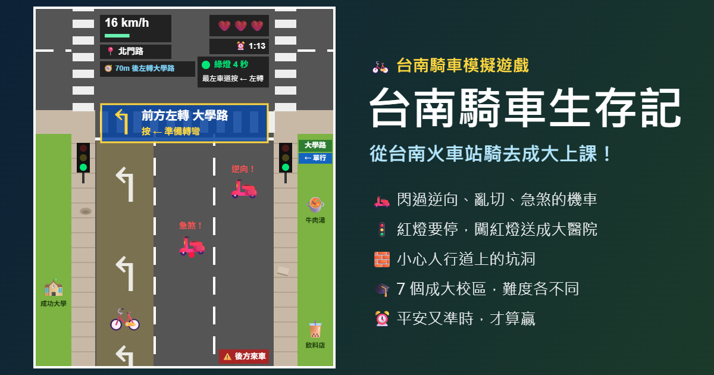

# 🚲 台南騎車生存記

從台南火車站騎腳踏車去成大上課！閃過逆向、亂切、急煞、闖紅燈的機車和人行道上的坑洞，平安又準時地抵達教室。

## 怎麼玩

| 按鍵 | 功能 |
|---|---|
| ↑ / ↓ | 踩踏板加速 / 煞車 |
| ← / → | 換車道（最左、最右可以騎上人行道） |
| 空白鍵 | 選單出發、結束後回到選單 |

- 在導航路口的**最左／最右車道**按方向鍵就能轉彎
- **紅燈一定要停**，闖紅燈會被撞、直接送成大醫院
- 時速低於 8 km/h 時，機車會繞過你（🛡️），但太慢會遲到
- 本遊戲需要鍵盤，請用電腦遊玩

## 目的地

7 個成大校區，依距離和沿途的事故熱點分成 ★～★★★★★ 難度。

## 資料說明

- 校區、系館、路名是真實的；事故熱點參考台南市警一分局公布的東區十大肇事路口（2021）與台南市十大易肇事路段
- 路線、轉彎方向和距離為了遊戲有簡化，不代表真實的騎車路線

## 技術

單一 HTML 檔（HTML5 Canvas + JavaScript），不需要安裝任何套件，可以直接部署到 Vercel 等靜態網站服務。
